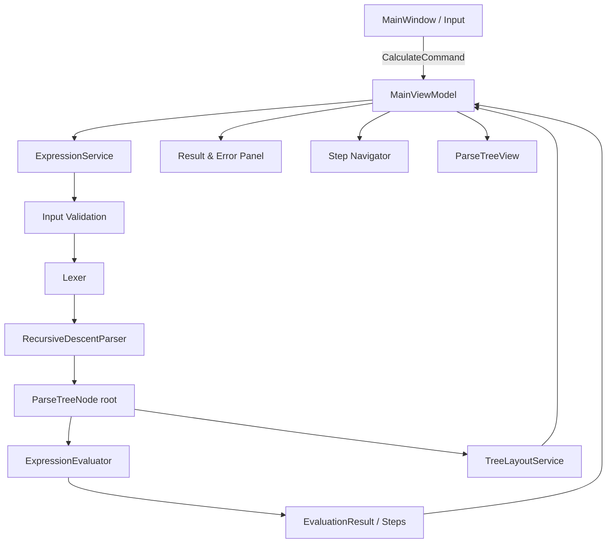

# ARCHITECTURE — Kiến trúc một project WPF / MVVM

## 1. Quyết định kiến trúc

- **Một project duy nhất**: `ExpressionEvaluator` (WPF), không tách Core/Tests sang project khác.
- **MVVM bằng CommunityToolkit.Mvvm**.
- Logic xử lý biểu thức **thuần C#**, không phụ thuộc `System.Windows` hoặc ViewModel.
- Parser tạo **một Parse Tree**, dùng trực tiếp cho tính toán và giao diện. **Không có AST**.
- Cây cú pháp **bất biến trong một lần phân tích**; Evaluator tạo `EvaluationResult` và `EvaluationStep` riêng.
- Không persistence, server, database, I/O mạng; không Unit Test tự động.

## 2. Cấu trúc thư mục đề xuất

```text
ExpressionEvaluator/
├── ExpressionEvaluator.csproj
├── App.xaml
├── App.xaml.cs
├── Models/
│   ├── TokenType.cs
│   ├── Token.cs
│   ├── SourceSpan.cs
│   ├── ParseTreeNode.cs
│   ├── OperationKind.cs
│   ├── EvaluationStepType.cs
│   ├── EvaluationStep.cs
│   ├── EvaluationResult.cs
│   ├── ExpressionError.cs
│   ├── ExpressionErrorCategory.cs
│   ├── ExpressionAnalysisResult.cs
│   ├── TreeNodePosition.cs
│   └── TreeLayoutResult.cs
├── Parsing/
│   ├── GrammarDefinition.cs
│   ├── Lexer.cs
│   └── RecursiveDescentParser.cs
├── Evaluation/
│   └── ExpressionEvaluator.cs
├── Services/
│   ├── ExpressionService.cs
│   ├── NumberFormatter.cs
│   ├── TreeLayoutService.cs
│   └── GrammarDialogService.cs
├── Exceptions/
│   ├── LexicalException.cs
│   └── ParseException.cs
├── ViewModels/
│   ├── MainViewModel.cs
│   ├── GrammarViewModel.cs
│   └── ParseTreeNodeViewModel.cs
├── Views/
│   ├── MainWindow.xaml
│   ├── MainWindow.xaml.cs
│   ├── GrammarDialog.xaml
│   ├── GrammarDialog.xaml.cs
│   └── Controls/
│       ├── ParseTreeView.xaml
│       └── ParseTreeView.xaml.cs
└── Resources/
    └── Theme.xaml
```

`Exceptions` chỉ chứa ngoại lệ cho lỗi tokenize/parse. Lỗi Evaluation được trả về dưới dạng `EvaluationResult` để **không mất các bước đã tính**.

## 3. Ranh giới trách nhiệm

| Lớp/thành phần | Phụ thuộc hợp lệ | Không được phụ thuộc |
|---|---|---|
| `Lexer` | `Models`, thư viện .NET chuẩn | WPF, ViewModel, TreeLayout |
| `RecursiveDescentParser` | `Models`, `Parsing` | WPF, Evaluator, ViewModel |
| `ExpressionEvaluator` | `Models` | WPF, Lexer, Parser, ViewModel |
| `ExpressionService` | Validation, Lexer, Parser, Evaluator | XAML, Canvas, Dialog |
| `NumberFormatter` | `decimal`, .NET | Logic parse |
| `TreeLayoutService` | `ParseTreeNode`, vị trí/biên | Trạng thái tính toán |
| `MainViewModel` | `ExpressionService`, `NumberFormatter`, dialog abstraction | Chi tiết cách vẽ Canvas |
| `ParseTreeView` | Vị trí cây / highlight từ VM | Tự tokenize/parse/evaluate |
| `GrammarDialog` | `GrammarViewModel` | Thay đổi CFG |

Giải pháp tạo dialog: dùng `GrammarDialogService` nhận yêu cầu hiển thị từ `MainViewModel`, giảm phụ thuộc trực tiếp vào `Window`. Trong một project đơn giản, khởi tạo thủ công bằng `App.xaml.cs`; không cần một DI container bên ngoài.

## 4. Sơ đồ luồng dữ liệu



Các mũi tên mô tả **dòng điều phối/dữ liệu**, không phải quan hệ kế thừa. Parser **không** trả AST và Evaluator **không** mutate cây.

## 5. Vòng đời một lần Calculate

1. `MainViewModel.Calculate()` đọc `InputExpression`.
2. Gọi `ExpressionService.Analyze(input)` một lần.
3. Service kiểm tra input, tokenize, parse, evaluate; chuyển các lỗi dự kiến sang `ExpressionAnalysisResult`.
4. `MainViewModel` gán `LastAnalyzedExpression = InputExpression` **kể cả khi thất bại**.
5. ViewModel thay **toàn bộ** `CurrentAnalysis`, reset `CurrentStepIndex = 0`, clear highlighted IDs; làm mới error/result/tree.
6. Nếu `ParseTree != null`, gọi `TreeLayoutService` một lần để có tọa độ cho các nút/đường nối.
7. Giao diện cập nhật theo Data Binding; nếu thành công, hiển thị `Value` ngay lập tức.
8. Bước kế tiếp/chuyển lùi chỉ gán `CurrentStepIndex` và `HighlightedNodeIds` từ `Steps` đã tạo.

**Không** gọi Parser/Evaluator từ nút Next/Previous.

## 6. Stale state — kết quả của biểu thức trước

ViewModel lưu:

- `InputExpression`: chuỗi đang nằm trong TextBox.
- `LastAnalyzedExpression`: chuỗi được Submit gần nhất, bất kể Submit thành công hay thất bại.
- `CurrentAnalysis`: kết quả của lần Submit đó (bao gồm lỗi, nếu có).
- `HasAnalysis`: đã từng Submit hay chưa.
- `IsResultOutdated = HasAnalysis && InputExpression != LastAnalyzedExpression`.

Khi nhập mà **chưa Submit**, không thay `CurrentAnalysis`. Có thể duyệt các bước của kết quả cũ. Bên trên Result/Tree hiển thị nhãn tiếng Việt như: **“Dữ liệu bên dưới thuộc biểu thức đã phân tích trước đó: …”**.

Khi Submit lại, thay trạng thái cũ bằng lần mới và reset stale = false. Lỗi syntax mới xóa tree cũ. Lỗi evaluator mới giữ tree mới và trace mới.

## 7. Tree layout và highlight

1. `TreeLayoutService` duyệt Parse Tree theo thứ tự, **loại các node `IsEpsilon` khỏi danh sách hiển thị**.
2. Đo/ước lượng kích thước nhãn của mỗi node; phân bổ vị trí **từ dưới lên** để giảm va chạm giữa các nhánh (căn giữa parent trên phạm vi children).
3. Trả `TreeLayoutResult` gồm kích thước mặt phẳng, `TreeNodePosition[]`, `TreeEdge[]`.
4. WPF `ParseTreeView` vẽ node và đường nối trong `Canvas`, bọc bằng `ScrollViewer` với thanh cuộn ngang/dọc `Auto`.
5. Mỗi node hiển thị được liên kết với `ParseTreeNodeViewModel.IsHighlighted` (hoặc thuộc tính tương đương), cập nhật khi đổi bước. **Không cần bố trí lại cây** khi Next/Previous.
6. `HighlightedNodeIds` chỉ gồm terminal toán tử và các node nguồn tham gia phép tính (có thể là nhiều nhánh); không highlight toàn bộ đường từ root như phương án nâng cao đã loại bỏ.

## 8. Ràng buộc WPF / MVVM

- `MainViewModel` nên khai báo `public partial class MainViewModel : ObservableObject`.
- `[ObservableProperty]` sinh observable property; `[RelayCommand]` sinh command. Với computed property, bảo đảm gọi `OnPropertyChanged`/`NotifyPropertyChangedFor` hợp lệ.
- `CalculateCommand` là synchronous command; với input tối đa 200 ký tự và phạm vi này không cần luồng nền.
- `NextStepCommand` chỉ bật khi `CurrentStepIndex < Steps.Count`; `PreviousStepCommand` chỉ bật khi `CurrentStepIndex > 0`. Gọi `NotifyCanExecuteChanged()` khi state thay đổi.
- Có thể liên kết Enter vào command bằng InputBinding hoặc cơ chế hợp lệ trong WPF; tránh triển khai logic tính toán riêng trong code-behind.
- Code-behind chỉ làm việc liên quan giao diện (khởi tạo, focus, chọn vị trí lỗi/scroll).
- Dialog có thể là modal, đóng lại không làm reset cây hay trace.
- Không hiển thị AST, không thêm plugin layout/graph hay navigation framework.

## 9. Quản lý lỗi

`ExpressionService` chuyển lỗi Input/Lexical/Syntax thành `ExpressionAnalysisResult(Error=..., ParseTree=null)`; không để exception dự kiến thoát đến UI. `Evaluator` tự tạo kết quả failure với `Steps` đã tính và `Error` step cuối. Thông tin lỗi có `Category`, `Code`, `Message`, `SourceSpan?`.

Nếu gặp ngoại lệ lập trình không dự kiến, có thể hiển thị thông báo chung và log trong môi trường phát triển; **không** giả mạo thành Syntax Error. Tập trung bắt riêng các lỗi dự kiến `DivideByZeroException`, `OverflowException` tại tầng đánh giá.

## 10. Biên kiểm thử và bảo trì

Kiểm thử thủ công các tầng bằng UI và bảng trường hợp trong `TEST_PLAN.md`. Không thêm `ExpressionEvaluator.Tests`. Khi thay đổi CFG cần cập nhật đồng bộ parser, danh mục grammar read-only và logic evaluator; **không** cho người dùng chỉnh CFG trực tiếp.
